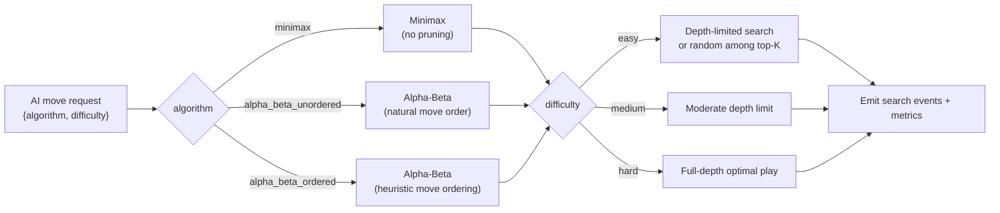

# Algorithm Design — Search Lab

This module implements the adversarial search strategies used by the
Tic-Tac-Toe AI (and, separately, the labeled RPS educational variant in
`GAME_THEORY_DESIGN.md`). Every strategy below operates on a
perfect-information, alternating-turn, zero-sum game tree.

## Strategy Selection Routing

## Minimax

Recursive evaluation over the full remaining game tree:

- **MAX nodes** (AI's own turn, if AI maximizes) select the child with
  the highest evaluated score.
- **MIN nodes** (opponent's turn) select the child with the lowest
  evaluated score.
- **Terminal scoring:** `+10 - depth` for an AI win, `depth - 10` for an
  opponent win, `0` for a draw — depth-adjustment rewards faster wins
  and slower losses.

## Alpha-Beta Pruning

Adds `alpha` (best value MAX can guarantee so far) and `beta` (best
value MIN can guarantee so far) to Minimax. A branch is pruned when
`alpha >= beta`, since the opposing player would never allow play to
reach it.

- **Unordered variant:** children visited in raw board-position order
  (0–8). Demonstrates pruning's correctness without relying on move
  quality.
- **Ordered variant:** children visited in a heuristic order (center →
  corners → edges, or by shallow static evaluation) to maximize early
  pruning. Used to demonstrate *why* move ordering affects pruning
  efficiency, not just that pruning helps.

Both variants are proven, by test, to return the same move choice as
plain Minimax on identical inputs (see `TESTING_STRATEGY.md`) — only
the node count and pruning pattern differ.

## Difficulty Levels

| Difficulty | Mechanism |
|---|---|
| Easy | Search depth capped low, or AI picks randomly among the top-K scored moves |
| Medium | Moderate depth cap, optimal within that horizon |
| Hard | Full-depth search, mathematically optimal (never loses) |

Difficulty only changes the *search horizon / move selection noise*,
never the correctness of Minimax/Alpha-Beta's evaluation at the depth
searched.

## Instrumentation

Every node visit and prune emits a structured event (schema defined in
`SEARCH_VISUALIZATION_DESIGN.md`) and increments per-request counters:

- `nodes_visited`
- `nodes_pruned`
- `max_depth_reached`
- `elapsed_ms`

These counters are the raw data behind the Phase 13 Algorithm
Comparison / Performance Analytics views.

## Performance Comparison Basis

Because Tic-Tac-Toe's full game tree is small (≤ 9! ≈ 362,880 terminal
paths, far fewer after symmetry and early termination), differences
between Minimax and Alpha-Beta are measured in **nodes visited**, not
wall-clock time, which is noisy at this scale — wall-clock is recorded
but presented as secondary to node-count comparisons.
