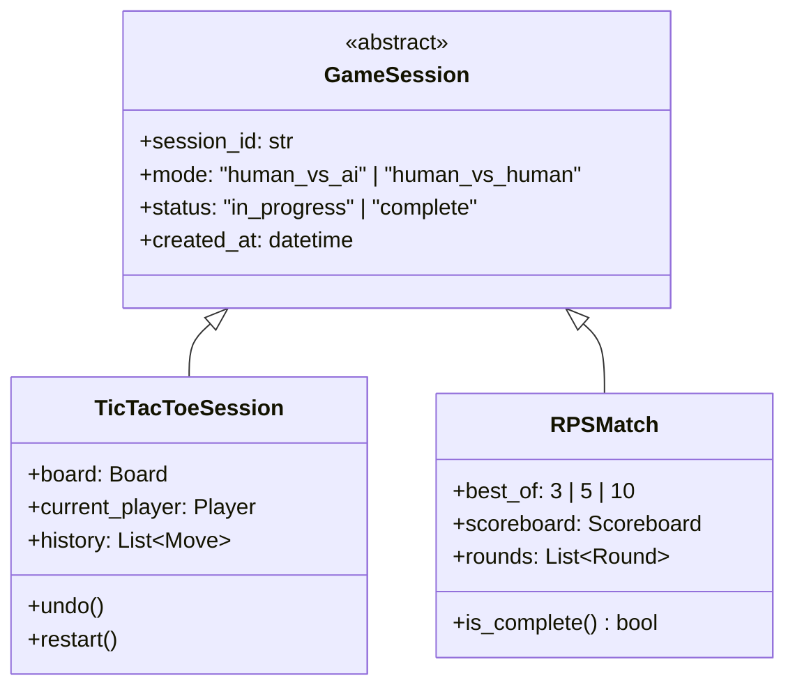

# Game Engine Design

## Shared Session Abstraction

Both games expose a session the frontend creates once and then drives
via moves/rounds:



Undo/restart is meaningful for Tic-Tac-Toe (a sequential game with a
mutable shared board) but not for an individual RPS round (simultaneous
and immutable once resolved); RPS instead supports starting a **new
match**, and "undo" only applies to not-yet-submitted human input.

## Tic-Tac-Toe Engine

**Board representation:** 3x3 grid, cells in `{EMPTY, X, O}`, addressed
`0`–`8` (row-major) for API simplicity and `(row, col)` internally.

**Core operations:**
- `apply_move(board, position, player) -> Board` — raises on occupied
  cell or out-of-turn player.
- `check_terminal(board) -> TerminalResult | None` — returns winner,
  winning line (for UI highlight), or `DRAW`.
- `legal_moves(board) -> list[int]`.
- `undo(session) -> Board` — pops the last move from `history`, restores
  prior board and turn.
- `restart(session) -> Board` — clears board and history, keeps the
  same `session_id` and selected AI settings.

**Move history record:**

```json
{
  "move_number": 3,
  "player": "X",
  "position": 4,
  "board_after": ["X", "O", "", "", "X", "", "", "", ""],
  "algorithm_used": "alpha_beta_ordered",
  "difficulty": "hard"
}
```

## Rock Paper Scissors Engine

**Choice domain:** `{ROCK, PAPER, SCISSORS}`.

**Resolution rule:** `ROCK` beats `SCISSORS`, `SCISSORS` beats `PAPER`,
`PAPER` beats `ROCK`; identical choices are a tied round (no score
change, still recorded in history).

**Match structure:**
- `best_of ∈ {3, 5, 10}` — match ends when either side reaches
  `ceil(best_of / 2)` round wins.
- `Scoreboard { human_wins, ai_wins (or player2_wins), ties }`.
- `Round { round_number, human_choice, opponent_choice, result, timestamp }`.

**Match history record:**

```json
{
  "round_number": 2,
  "human_choice": "ROCK",
  "opponent_choice": "SCISSORS",
  "result": "human_win",
  "strategy_used": "nash_uniform"
}
```

## Human vs. Human Mode

Both engines support a second local/alternating human player by simply
not invoking the AI/strategy service for the opposing move — the same
engine and validation path is reused, with `player_type` on each side
set to `human` instead of `ai`. No separate code path is introduced.

## Error Handling

Both engines raise typed domain errors (`IllegalMoveError`,
`SessionNotFoundError`, `MatchAlreadyCompleteError`) that the API layer
maps to the HTTP error schema in `API_SPECIFICATION.md`. Only
boundary input (HTTP payloads) is validated; internal calls trust
engine invariants.
