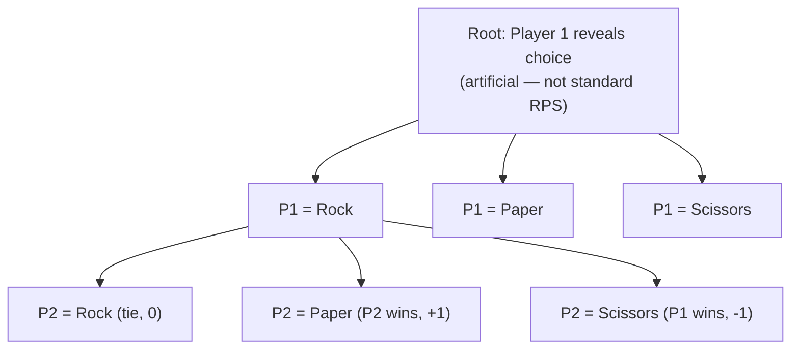

# Game Theory Design — Rock Paper Scissors

## Why Alpha-Beta Does Not Apply to Standard RPS

Minimax and Alpha-Beta Pruning are designed for **sequential,
perfect-information, zero-sum games** — at each node, the player to
move knows the complete history of prior moves (Tic-Tac-Toe fits this
exactly). Standard one-round RPS is a **simultaneous-action game**:
neither player observes the other's choice before committing their
own. There is no "second mover" with information to search over, so
there is no meaningful game tree to minimax — any node for "player 2's
response" would have to pretend player 2 can see player 1's move,
which is not the game being modeled.

**This platform must never present standard simultaneous RPS as solved
by alternating-turn Alpha-Beta.** The correct tool is a payoff matrix
plus mixed-strategy (Nash) equilibrium analysis, below.

## Zero-Sum Payoff Matrix

Payoffs below are from the row player's perspective (`+1` win, `0`
tie, `-1` loss); the column player's payoff is always the negation
(zero-sum):

| Row \ Column | Rock | Paper | Scissors |
|---|---|---|---|
| **Rock**     | 0  | -1 | +1 |
| **Paper**    | +1 | 0  | -1 |
| **Scissors** | -1 | +1 | 0  |

## Mixed-Strategy Nash Equilibrium

Because RPS has no pure-strategy equilibrium (any fixed choice is beaten
by a specific counter-choice), the equilibrium is a probability
distribution over choices such that the opponent cannot gain by
deviating.

**Symmetry argument:** the payoff matrix is invariant under cyclic
relabeling `Rock → Paper → Scissors → Rock`. Any equilibrium must
therefore also be invariant under that relabeling, which forces equal
probability on all three options:

```
P(Rock) = P(Paper) = P(Scissors) = 1/3
```

**Verification — indifference condition:** at equilibrium, the
opponent's expected payoff must be equal no matter which single option
they play against the row player's mixed strategy (otherwise they'd
deviate to the better one). Against `(1/3, 1/3, 1/3)`, playing Rock
yields:

```
E[Rock] = 1/3·(0) + 1/3·(-1) + 1/3·(+1) = 0
```

By the same symmetry, `E[Paper] = E[Scissors] = 0` as well — every pure
response yields the same expected payoff (0), so the opponent has no
profitable deviation. This confirms `(1/3, 1/3, 1/3)` is a Nash
equilibrium, and the game's value is `0` (fair game).

## Exploitability

If either player deviates from `(1/3, 1/3, 1/3)`, they become
exploitable: an opponent who best-responds to a known bias achieves a
strictly positive expected payoff. For example, against a `biased_fixed`
strategy that overplays Rock, the best response is to overplay Paper.
This is the basis for the `pattern_adaptive` AI strategy and the
"Strategy Analytics" view, which shows a player's empirical choice
frequencies drifting away from `1/3` and the resulting exploitability.

## Mapping to the Platform

| Concept | Where it surfaces |
|---|---|
| Payoff matrix | RPS Strategy Matrix page (Algorithm Labs) |
| Equilibrium probabilities | Probability visualization (bar/pie, dashboard theme) |
| Expected value at equilibrium (0) | Strategy Analytics summary |
| Exploitability of biased play | Strategy Analytics, `pattern_adaptive` AI demo |
| Sequential-search teaching tool | Educational Sequential Variant (below) — never the default |

## Educational Sequential Variant (Phase 11)

To let learners see Alpha-Beta mechanics (MAX/MIN, alpha/beta updates,
pruning) applied to a small branching factor without the complexity of
Tic-Tac-Toe's 9 cells, the platform offers an explicitly separate mode:
one player's choice is artificially revealed first, turning the round
into a 2-ply sequential game the second player then "solves" with
Alpha-Beta.



**This variant is clearly labeled "Educational — Sequential Variant,
Not Standard RPS" everywhere it appears in the UI**, is reached only
from the Algorithm Labs, and is never used to claim that real RPS
strategy is "solved" by search — real RPS strategy is governed by the
mixed-strategy equilibrium above.
