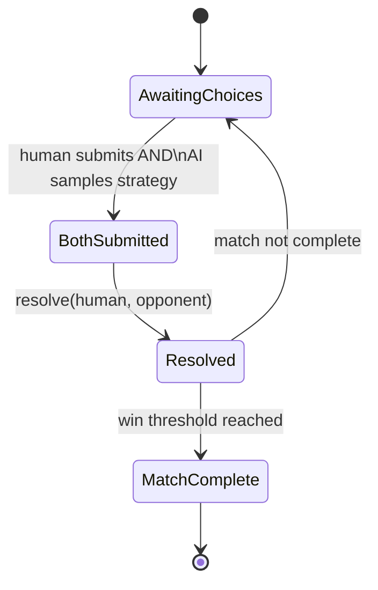

# Rock Paper Scissors — Design

## Standard Game Model

Standard RPS is a **simultaneous-action, one-shot, zero-sum game** —
both players commit a choice without observing the other's choice.
This is fundamentally different from Tic-Tac-Toe's alternating,
perfect-information structure. See
[`GAME_THEORY_DESIGN.md`](./GAME_THEORY_DESIGN.md) for why this means
standard RPS is **not** analyzed with Minimax/Alpha-Beta, but with a
payoff matrix and mixed-strategy equilibrium instead.

## Round Flow



The AI's choice is sampled from its selected strategy **independently
of and without access to** the human's choice for that round —
preserving simultaneity even though the implementation is a single
backend process.

## Match Formats

| Format | Win threshold |
|---|---|
| Best of 3 | 2 round wins |
| Best of 5 | 3 round wins |
| Best of 10 | 6 round wins |

Ties do not count toward either player's win total and do not end the
match.

## AI Strategy Selection

| Strategy | Behavior | Purpose |
|---|---|---|
| `nash_uniform` | Plays Rock/Paper/Scissors each with probability 1/3, independent of history | Unexploitable — the game-theoretic optimum (see `GAME_THEORY_DESIGN.md`) |
| `biased_fixed` | Plays a fixed non-uniform distribution (e.g. favors Rock) | Teaching tool: shown to be exploitable once the human notices the bias |
| `pattern_adaptive` | Tracks the human's recent choice frequencies / transitions and best-responds | Teaching tool: shows how deviating from equilibrium gets punished |
| `sequential_educational` | Alpha-Beta over an artificially revealed first move — **not standard RPS** | Phase 11 teaching tool for search-tree mechanics only |

The frontend AI-strategy selector for standard play only lists
`nash_uniform`, `biased_fixed`, and `pattern_adaptive`.
`sequential_educational` is only reachable from the Algorithm Labs →
"RPS Strategy Matrix" page, behind the explicit educational-mode label.

## Scoreboard & Match History Data Model

```json
{
  "match_id": "m_0007",
  "best_of": 5,
  "mode": "human_vs_ai",
  "ai_strategy": "nash_uniform",
  "scoreboard": { "human_wins": 2, "opponent_wins": 1, "ties": 1 },
  "rounds": [
    { "round_number": 1, "human_choice": "ROCK", "opponent_choice": "SCISSORS", "result": "human_win" },
    { "round_number": 2, "human_choice": "PAPER", "opponent_choice": "PAPER", "result": "tie" },
    { "round_number": 3, "human_choice": "SCISSORS", "opponent_choice": "ROCK", "result": "opponent_win" },
    { "round_number": 4, "human_choice": "ROCK", "opponent_choice": "SCISSORS", "result": "human_win" }
  ],
  "status": "in_progress"
}
```

## Human vs. Human Mode

Identical match/round structure; both choices come from local human
input (e.g. alternating reveal on one device, or two labeled input
panels) rather than from a strategy sampler. No separate data model.

## UI Pages

- **Game page** (dashboard theme): choice buttons, round result
  animation, scoreboard, match history list, best-of selector.
- **RPS Strategy Matrix** (Algorithm Labs, graph theme for the
  decision-tree panel / dashboard theme for the matrix panel): payoff
  matrix grid, equilibrium probability bars, strategy selector,
  entry point to the labeled educational sequential variant.
