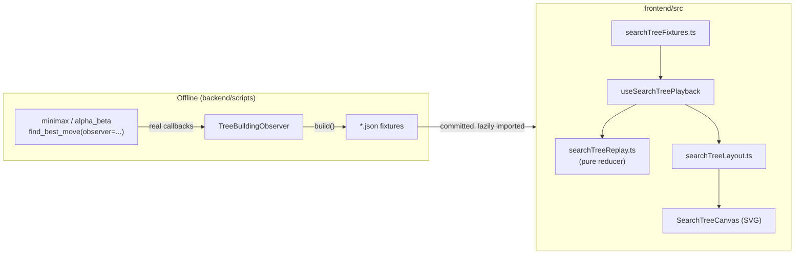

# Search Tree Visualization (Phase 7)

An interactive visualization of the *real* Minimax and Alpha-Beta
searches built in Phases 5-6 — not a redrawn or fabricated tree.
Backend: `backend/app/algorithms/visualization/`. Frontend:
`frontend/src/{types/searchTree.ts, lib/searchTree*.ts,
hooks/useSearchTree*.ts, components/graph/search-tree/}`.

## 0. Scope Boundary — No Dynamic/Arbitrary Position Analysis

**Audited and confirmed explicitly:** this phase does **not** let a
user build or select an arbitrary Tic-Tac-Toe board and run the real
solver on it. `SearchConfigPanel`'s "Position" control is a dropdown
over exactly `AVAILABLE_POSITIONS` (`lib/searchTreeFixtures.ts`,
currently 2 entries); `useSearchTreeExplorer.run()` only ever resolves
`{positionId}-{algorithm}` against a hardcoded map of 4 static
`import()` calls. Nothing in the frontend constructs a
`TicTacToeGame` from user input or invokes
`app.algorithms.minimax`/`app.algorithms.alpha_beta` at runtime — the
Python solvers only ever run offline, inside
`generate_visualization_fixtures.py`.

This is a deliberate boundary, not an oversight: Phase 7 explicitly
excludes FastAPI, and a browser cannot execute Python directly, so
there is no safe way to analyze an arbitrary user-constructed position
right now. Building a "custom board" input with nowhere genuine to
send it would itself be a decorative control that does nothing — the
UI is instead labeled honestly everywhere a position is chosen (the
Position dropdown, the Comparison Workspace's shared selector, and
each lab page's explanation text all say "precomputed demonstration,
not a live custom board").

**Phase 12 integration boundary (the minimal correct fix, specified
but not built here):**

```
POST /api/v1/tic-tac-toe/analyze
  body: { board: string[9], ai_player: "X" | "O", algorithm: "minimax" | "alpha_beta" }
  response: SearchTreeData.to_dict()  # identical shape to today's fixtures
```

The handler is a thin wrapper over code that **already exists and
needs no changes**:

```python
game = TicTacToeGame.from_board(board, ai_player)  # new: see validation below
tree = build_search_tree(game, ai_player, algorithm)  # unchanged, tree_builder.py
return tree.to_dict()  # unchanged, models.py
```

`build_search_tree` and `TreeBuildingObserver` need zero modification
— only a request-validation step is new, and it should **reuse the
engine's own rules**, not invent parallel ones:

- Board must be exactly 9 cells, each `""`, `"X"`, or `"O"` (reuse
  `Mark`).
- Reconstructing the position by replaying it move-by-move through
  `TicTacToeGame.make_move()` automatically rejects: wrong cell count/
  values (`InvalidPositionError`), an already-occupied target
  (`OccupiedCellError`), and — critically — **impossible positions**
  (both players having a winning line, or a turn-count mismatch)
  simply never arise if a position is only ever reached by legitimate
  alternating `make_move()` calls from an empty board. A request that
  supplies a raw 9-cell board (not a move list) instead needs an
  explicit reconstruction/validation helper that checks: cell counts
  differ by exactly 0 or 1 (X moves first), at most one player has a
  winning line (both-winning is impossible and must be rejected), and
  the game is not already over (`evaluate_board` returns
  `IN_PROGRESS`) — this belongs in a small new validator function,
  not duplicated ad hoc in the endpoint.
- Whose-turn-it-is is derived from the board (not separately trusted
  from the client), exactly like the engine already does.

No such endpoint or validator was implemented in this phase — this
section only specifies the integration boundary precisely enough that
Phase 12 can build it without re-deriving the design.

## 1. Architecture



No FastAPI endpoint exists in this phase (explicitly out of scope).
Instead, `backend/scripts/generate_visualization_fixtures.py` runs the
real solvers once, offline, with the adapter attached, and writes
their genuine output as static JSON the frontend loads and replays.
This keeps the "no backend API yet" boundary intact while still using
only real, non-fabricated search data.

## 2. Event Flow — From Observer Callback to Rendered Node

`TreeBuildingObserver` (`backend/app/algorithms/visualization/tree_builder.py`)
implements both `minimax.observer.SearchObserver` and
`alpha_beta.observer.SearchObserver` with **one unchanged class** —
neither Protocol was modified. It:

1. Assigns every node a deterministic id (`n0`, `n1`, …) from a single
   monotonic counter, in true discovery order.
2. Maintains a call-stack mirroring the solver's actual recursion
   (`on_node_entered` pushes, `on_value_returned` pops), so
   parent/child relationships come directly from real recursion, never
   guessed afterward.
3. Appends every callback as a flat, ordered event dict — the
   replayable "source of truth" — and also maintains a derived
   `VisualNode` index (final state), useful for convenience but always
   reconstructible from replaying `events` in order.
4. For Alpha-Beta's `on_branch_pruned`, creates a **stub** node:
   `board=None`, `evaluation=None`, no children — because the
   algorithm genuinely never evaluated it. This is the mechanism that
   guarantees a pruned branch can never be displayed as though its
   descendants were evaluated.

See `backend/tests/algorithms/test_visualization.py` (27 tests) for
the adapter's own correctness proof: node-id determinism,
parent/child consistency, terminal/pruned representation, JSON
round-tripping, and — critically — that attaching the observer never
changes what either algorithm actually decides.

## 3. Visualization Data Model

`frontend/src/types/searchTree.ts` mirrors the backend's `to_dict()`
output exactly: `VisualNode` (id, parentId, depth, role, board, move,
status, evaluation, alpha, beta, isTerminal, terminalResult,
childrenIds) and `SearchEvent` (the ordered, replayable log). A node's
`status` is one of `"visited"` (open, still exploring children),
`"evaluated"` (terminal, scored), `"completed"` (non-terminal,
returned a backed-up value), or `"pruned"` (stub, never explored).

## 4. Playback Model

`frontend/src/lib/searchTreeReplay.ts` is a **pure** reducer:
`applyEvent(state, event) -> newState`. It never invents a node or a
value — every branch of its `switch` only reshapes a field the event
itself already carries. `useSearchTreePlayback`
(`frontend/src/hooks/useSearchTreePlayback.ts`) drives an index into
the real `events` array:

- `next()` / autoplay ticks apply exactly one more real event
  (O(1) — fast forward never recomputes from scratch).
- `previous()` / `jumpTo()` rebuild from `events[0..target]` via
  `buildStateAtIndex` (O(target) — acceptable since these are
  deliberate, infrequent user actions, not per-frame work).
- `reset()` returns to the empty pre-search state.
- Playback automatically resets whenever the `events` array reference
  itself changes (a different fixture was loaded) — implemented as
  React's "adjust state during render" pattern, not an effect, after
  an oxlint `set-state-in-effect` warning surfaced that the original
  effect-based version was both the wrong pattern *and* (once
  "fixed" naively with a ref) caused an actual infinite-render-loop
  bug, caught by the test suite — see §9.

Every playback control (play/pause/next/previous/reset/scrub) is real
and fully wired; none are decorative.

## 5. Large-Tree Performance Strategy

The brief's headline concern — an empty-board Minimax search visits
~550,000 nodes — is handled by **never rendering an unbounded tree**,
regardless of how large the underlying search was:

1. **No fixture is shipped for the empty board.** The two shipped
   positions ("Immediate win available", small; "Must block opponent
   win", large — 1,019 Minimax nodes / 3,530 events) were chosen to
   demonstrate the real mechanics clearly without a multi-megabyte
   bundled asset. The adapter and generation script fully support
   larger positions (see §10, Known Limitations, for how to generate
   them yourself) — they are simply not pre-generated here.
2. **Nothing loads automatically.** `SearchConfigPanel` always starts
   with no fixture loaded; the user must press Run. A "large"-tier
   position additionally requires an explicit "I understand, show it
   anyway" acknowledgement before Run is enabled.
3. **Lazy, code-split loading.** Each fixture JSON is an explicit,
   separate dynamic `import()` (`searchTreeFixtures.ts`) — Vite splits
   each into its own chunk; the production build confirms this
   (`must-block-minimax-*.js` ships as its own ~636KB chunk, never
   part of the main bundle).
4. **Bounded rendering regardless of how much has been revealed.**
   `selectRenderedNodes` (`searchTreeLayout.ts`) applies a user-set
   depth filter and a hard node cap (default 250, adjustable 20–600);
   once revealed nodes exceed the cap, it keeps the *active path*
   (so the node currently being explored is never hidden) and fills
   the remaining budget with the most recently discovered nodes,
   discarding older ones from the render — never silently discarding
   from the underlying `events`/`revealedNodes` data, only from what
   gets laid out and drawn.
5. **Totals are always shown, never implied to be "everything rendered".**
   `AlgorithmStatsPanel` always displays the real
   `nodes_visited`/`terminal_nodes`/`branches_pruned` from the
   solver's own statistics *and*, separately, "revealed so far",
   "currently rendered", and "hidden by filter" counts — the
   filtered view is never presented as the complete tree.
6. **Plain SVG, no graph library.** Justification: even the "large"
   shipped fixture only ever needs a few hundred nodes on screen at
   once once filtered/windowed — well within what SVG handles
   smoothly. A canvas/WebGL renderer or a general-purpose graph
   library (e.g. react-flow, d3-hierarchy) would be unused weight for
   this project's actual rendered scale; see
   `components/graph/search-tree/SearchTreeCanvas.tsx`'s own
   docstring for the same reasoning in context.

## 6. Filtering Behavior

Depth filter and node cap only change `selectRenderedNodes`'s output
(a `Set` of ids to draw) — they never mutate `revealedNodes`,
`events`, or any solver-reported statistic. `searchTreeLayout.test.ts`
asserts this directly (`"never mutates the input nodes map"`).
Narrowing a filter and widening it back always returns to the same
revealed set, because filtering reads the already-replayed state; it
never discards it.

## 7. Comparison Calculations

`ComparisonWorkspace` runs both algorithms on one shared, user-selected
position and `ComparisonSummary` reports, straight from each fixture's
own recorded `statistics`/`bestMove` (no recomputation):
evaluations-match, best-move-match, nodes visited (both), branches
pruned, and node-reduction percentage
(`((mmNodes - abNodes) / mmNodes) * 100`). Execution time is shown but
explicitly captioned as environment-dependent, never asserted as a
guaranteed comparison metric — matching
`docs/ALGORITHM_COMPARISON.md`'s own methodology note.

## 8. Mobile Behavior

Phase 3 documented a simplification: graph-theme panels stacked
vertically on mobile instead of using bottom sheets. Phase 7 revisits
this specifically for the search-tree pages, which now have real,
data-rich panels worth reclaiming screen space for:
`components/layout/BottomSheet.tsx` is a new, reusable mobile sheet,
and `SearchTreeExplorerView` opens Configuration/Statistics/Node Detail
in it via three toolbar buttons on narrow viewports, while the desktop
3-column layout (config | canvas+controls | stats+inspector+legend)
is unchanged.

## 9. Testing

**Backend** (`backend/tests/algorithms/test_visualization.py`, 27
tests): adapter output matches the real solver result exactly; node
ids are deterministic and unique; parent/child links are internally
consistent; terminal nodes are marked `evaluated` with real
board/value data; pruned nodes have no board, no evaluation, no
children; cutoff/branch-pruned event counts match the solver's own
statistics; JSON round-trips with no circular references; malformed/
out-of-order observer calls (e.g. `on_value_returned` with nothing
open) don't raise; and — directly addressing "verify existing
algorithm behavior remains unchanged" — the same position produces an
identical `MinimaxResult`/`AlphaBetaResult` whether or not the
visualization observer is attached.

**Frontend** (43 tests across 7 files): `searchTreeReplay.test.ts`
(pure reducer correctness, including pruned-stub shape and
incremental-vs-one-shot replay equivalence); `searchTreeLayout.test.ts`
(depth filter, node-cap windowing keeps the active path, and — the
explicit brief requirement — filtering never mutates the underlying
node map); `useSearchTreePlayback.test.ts` (next/previous/reset/
play/pause/jumpTo, autoplay via fake timers, auto-reset on a changed
event sequence); `MinimaxExplorerPage.test.tsx` (no automatic run;
Run loads the real fixture; Next advances; selecting a node populates
the inspector; Reset returns to the initial state); and
`ComparisonWorkspace.test.tsx` (no automatic run; Run Comparison loads
both real fixtures and displays their actual matching evaluation/
best-move/node-count statistics).

An infinite-render-loop bug (`fixture?.events ?? []` creating a new
array reference every render) was caught by this suite during
development and fixed by using a stable module-level empty-array
constant — see `useSearchTreeExplorer.ts`.

## 10. How to Run and Test

```bash
# Backend
cd backend
pytest tests/algorithms/test_visualization.py -v
# Regenerate fixtures (only needed if the curated position list or
# either solver changes):
PYTHONPATH=. python scripts/generate_visualization_fixtures.py

# Frontend
cd frontend
npm run test        # Vitest
npx tsc -b           # type check
npm run build        # production build
npm run lint          # oxlint
```

## 11. Known Limitations

- The empty-board search (549,946 nodes) is not shipped as a fixture
  — generating and bundling it as static JSON would add ~tens of MB
  to the repository for a tree no UI could usefully render anyway.
  The adapter supports it (`build_search_tree(TicTacToeGame(), "X",
  "minimax")`); it is simply not pre-generated here. A future FastAPI
  phase could compute arbitrary positions on demand instead of relying
  on pre-generated fixtures at all.
- Layout is a simple tidy-tree (leaves sequential, parents centered
  over their rendered children) — not edge-crossing-optimized. This
  is sufficient at the node counts actually rendered (bounded by the
  node cap) but would look cluttered without that cap.
- The "large" position's Minimax fixture (798,252 bytes raw JSON,
  1,019 nodes, 3,530 events) is noticeably heavier to load than the
  small one; this is the dataset the explicit "large dataset" warning
  covers. **Audited:** it gzip-compresses to 54,631 bytes (93.2%
  smaller) — matching the ~51.6KB the production build's own chunk
  report already showed — so real-world transfer over any
  gzip-capable server/CDN is modest even though the raw/bundled sizes
  look large in isolation. No events were removed or aggregated to
  shrink this file; the full, real 3,530-event sequence ships intact.
  See `docs/SEARCH_TREE_VISUALIZATION.md`'s own generation, which
  writes compact (non-indented) JSON already — the only further lever
  would be dropping real data, which was deliberately not done.
- No dynamic/arbitrary position analysis exists — see §0. This is the
  most significant functional gap identified by the Phase 7
  post-implementation audit; the fix is the documented Phase 12
  integration boundary, not a client-side workaround.
- Pan/zoom is a hand-rolled CSS-transform implementation (consistent
  with Phase 3's existing `GraphCanvas`), not a full gesture library —
  no pinch-zoom on touch devices yet, only drag-to-pan and button
  zoom.

### Fixture Integrity — Audit Results

All 4 shipped fixtures were independently re-verified (not just
trusted from the generator) against **fresh, separate** solver runs:

- Regenerating all fixtures twice in a row produces byte-identical
  output except for `statistics.execution_time_ms` (the one
  documented non-deterministic field — real wall-clock timing).
- For every fixture: event `index` values are sequential from 0;
  every node id is unique; every `childrenIds` entry correctly
  back-references its parent; every `pruned` node has `board: null`,
  `evaluation: null`, and no children; `initialMoves` matches between
  a position's `minimax` and `alpha_beta` fixture pair; and
  `nodes_visited`/`terminal_nodes`/`bestMove` all match a **freshly
  and independently invoked** `find_best_move` call (not the
  generator script, a separate direct call), confirming the fixture
  genuinely reflects real solver output. `manifest.json`'s
  `nodeCount`/`eventCount`/`nodesVisited` fields match the
  corresponding fixture file exactly.
