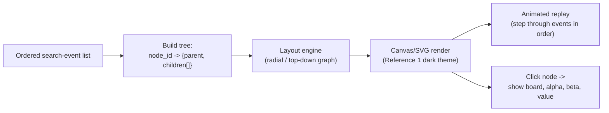

# Search Visualization Design

## Purpose

Render the Minimax/Alpha-Beta search as an explorable graph (the
"graph theme" — see `UI_UX_DESIGN.md`), so a learner can see every
node the algorithm visited, every branch it pruned, and why.

## Search-Event Schema

The Search Lab (see `ALGORITHM_DESIGN.md`) emits one event per node
touched during a search. The full ordered list is returned alongside
the chosen move, and also drives the animated "search path" replay in
Reference 1's visualization style.

```json
{
  "event_id": "evt_0042",
  "node_id": "n_17",
  "parent_id": "n_9",
  "depth": 3,
  "player_to_move": "MIN",
  "board_state": ["X", "O", "X", "", "X", "", "", "O", ""],
  "move_made": 4,
  "type": "visit",
  "alpha": 10,
  "beta": -5,
  "value": null,
  "prune_reason": null,
  "timestamp_ms": 12.4
}
```

`type` is one of:

| Type | Meaning |
|---|---|
| `visit` | Node entered, evaluation not yet complete |
| `evaluate` | Terminal node scored (`value` populated) |
| `backpropagate` | Value returned to parent (`value` populated at parent) |
| `prune` | Remaining siblings skipped (`prune_reason` populated, e.g. `"alpha (10) >= beta (-5)"`) |

## Tree Construction (Frontend)



## Visualization Requirements (Reference 1 theme)

- Black/navy background, nodes colored by role: cyan = MAX node,
  purple = MIN node, dimmed/greyed = pruned subtree root.
- Glowing edges along the path actually taken by the final move.
- Animated search path: events replay in emission order, each node
  "lighting up" as it's visited.
- Node inspection panel: clicking a node shows its board snapshot,
  depth, alpha/beta at that point, resulting value, and (if pruned)
  the human-readable prune reason.
- Left-side controls: algorithm/difficulty selectors, play/pause/step
  replay controls, "ordered vs. unordered" toggle.
- Zoom and pan on the graph canvas.

## Pruning Explanation Text

Generated from the `prune_reason` field using a template, e.g.:

> "Pruned 3 remaining moves at this node — once MIN found a reply
> worth **-5**, and MAX already had a guaranteed **10** elsewhere,
> MAX would never choose this branch, so Alpha-Beta skips it."

## Reuse for RPS Educational Sequential Variant

The same event schema, tree builder, and visualization component are
reused unchanged for the RPS educational sequential variant described
in `GAME_THEORY_DESIGN.md` — only the board-state field becomes a
choice-sequence snapshot (e.g. `{"p1": "ROCK", "p2": null}`), and the
page wrapper adds the "Educational — Sequential Variant, Not Standard
RPS" label required by Phase 11.
