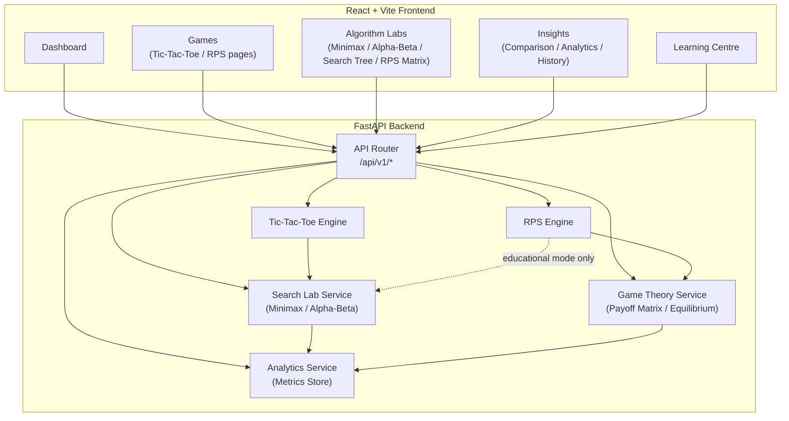
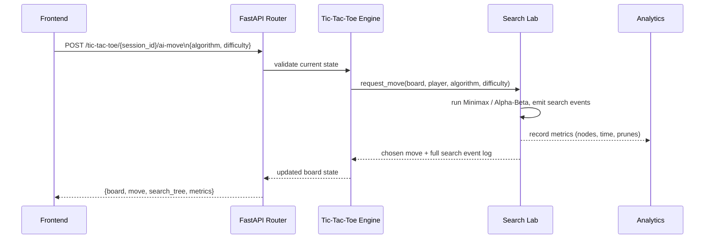
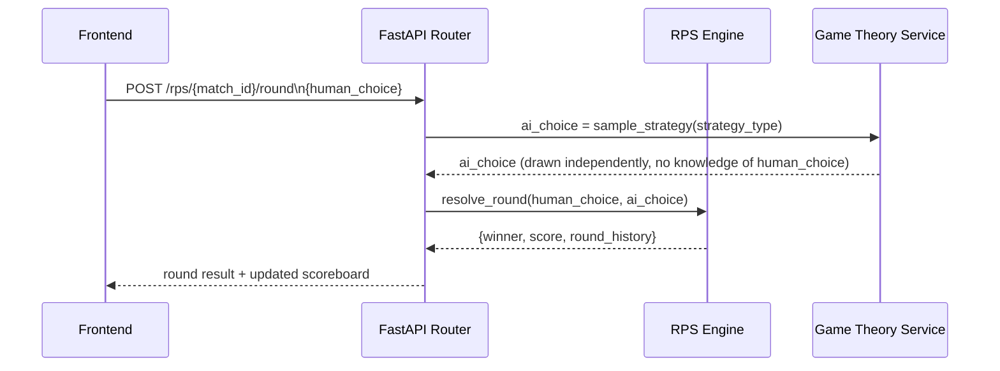

# System Architecture

## Overview

Competitive AI Game Lab is a single-page React application backed by
one FastAPI service. The backend hosts two independent game modules
(Tic-Tac-Toe, Rock Paper Scissors) and a shared "Search Lab" module
that both games' AI opponents emit events into, so the frontend can
visualize and compare them with one set of components.

## Module Boundaries

| Module | Responsibility | Used By |
|---|---|---|
| `tic_tac_toe` engine | Board state, rules, move history, undo/restart | Tic-Tac-Toe gameplay |
| `rps` engine | Round state, choice resolution, best-of-N match logic, scoreboard | RPS gameplay |
| `search_lab` | Minimax / Alpha-Beta (ordered & unordered) search, instrumented with search-event emission | Tic-Tac-Toe AI, RPS educational sequential variant |
| `game_theory` | Payoff matrix construction, mixed-strategy equilibrium, exploitability analysis | RPS strategy matrix, RPS AI strategy selection |
| `analytics` | Stores per-run metrics (nodes explored, time, pruning ratio) for comparison views | Insights section |

`search_lab` is intentionally the **only** module that implements
Minimax/Alpha-Beta. RPS's standard (simultaneous) mode never calls it;
only the separately labeled educational sequential variant does — see
[`GAME_THEORY_DESIGN.md`](./GAME_THEORY_DESIGN.md) and
[`ROCK_PAPER_SCISSORS_DESIGN.md`](./ROCK_PAPER_SCISSORS_DESIGN.md) for
why that distinction matters.

## Request Flow — Tic-Tac-Toe AI Move

## Request Flow — RPS Standard Round

Note the AI's choice is sampled **before and independently of** the
human's revealed choice — this preserves the simultaneous-action
property that makes the payoff-matrix/equilibrium analysis valid.

## Frontend Page Map

See [`UI_UX_DESIGN.md`](./UI_UX_DESIGN.md) for the full navigation
structure, route list, and theme assignment per page.

## Technology Stack

| Layer | Technology |
|---|---|
| Frontend | React, Vite, Tailwind CSS, Framer Motion, Recharts, Vitest |
| Backend | Python, FastAPI, Pytest |
| Algorithms | Minimax, Alpha-Beta Pruning (ordered/unordered), mixed-strategy game theory |
| Transport | REST over HTTP/JSON (see `API_SPECIFICATION.md`) |

No persistence layer (database) is planned for this phase; game and
match state live in backend session memory, scoped by `session_id` /
`match_id`.
