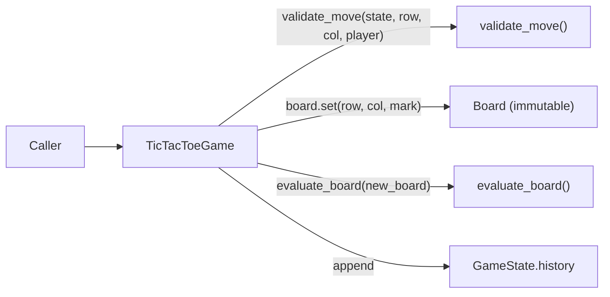

# Tic-Tac-Toe Engine (Phase 4)

Location: `backend/app/games/tic_tac_toe/`. Pure Python, rules only —
no AI, no HTTP, no persistence. This document describes the engine as
actually implemented in Phase 4.

## 1. Engine Architecture

Five responsibilities are kept in separate places, per the Phase 4
brief's architectural requirement:

| Responsibility | Lives in |
|---|---|
| State representation | `models.py` (`Board`, `Move`, `GameState`) |
| Move validation | `engine.validate_move()` |
| Rule evaluation (win/draw) | `engine.evaluate_board()` |
| State transitions | `TicTacToeGame.make_move()` / `.undo()` / `.restart()` |
| Move history | `GameState.history` (built up by state transitions, read via `TicTacToeGame.history`) |

`TicTacToeGame` is the only class most callers touch; it composes the
other four pieces rather than doing everything itself.



The engine is deterministic: no `random`, no AI decision-making, no
knowledge of HTTP requests, Pydantic, or React.

## 2. State Model

`GameState` (frozen dataclass) is a single, immutable snapshot:

```python
@dataclass(frozen=True)
class GameState:
    board: Board
    current_player: Mark
    status: GameStatus
    winner: Mark | None
    history: tuple[Move, ...]
    last_move: Move | None
    winning_line: WinningLine | None
```

`TicTacToeGame` holds a **list of snapshots** (one per ply, starting
with the empty-board snapshot), not a single mutable state:

- A move that passes validation computes a brand-new `GameState` and
  appends it — the previous snapshot is left untouched.
- `undo()` is just `list.pop()` — it needs no inverse-move logic
  because the exact prior snapshot is already sitting there.
- `move_count` is **derived** (`len(history)`), not stored as its own
  field, so it can never drift out of sync with the history.

## 3. Board Representation

`Board` wraps an immutable `tuple[tuple[Mark, ...], ...]` — a 3x3 grid
of `Mark.EMPTY | Mark.X | Mark.O`. `Board.set(row, col, mark)` returns
a **new** `Board`; it never mutates the one it was called on. Public
accessors (`TicTacToeGame.board`, `.board_flat`) return freshly
constructed `list`s on every call, so holding onto a previous result
and mutating it can never reach back into the engine's real state.

## 4. Coordinate Convention

- `row ∈ {0, 1, 2}`, `row = 0` is the **top** row, `row = 2` is the
  **bottom** row.
- `col ∈ {0, 1, 2}`, `col = 0` is the **left** column, `col = 2` is
  the **right** column.
- The flat, row-major index used for JSON/API compatibility is
  `position = row * 3 + col` (range 0-8), matching the board shape
  already documented in `docs/API_SPECIFICATION.md`.

This convention is used consistently in `models.py`, `engine.py`, and
every test in `backend/tests/test_tic_tac_toe.py`.

## 5. Game Rules

- New game: empty board, `X` to move, status `IN_PROGRESS`, empty
  history — `GameState.new_game()` / `TicTacToeGame()`.
- A move only succeeds if the game is in progress, the target cell is
  on the board and empty, and (if the caller explicitly named a
  player) that player is actually up to move.
- After a valid move: board updates, the move is appended to history,
  win/draw is (re-)evaluated, and the turn switches **only if the
  game is still in progress** — a game-ending move leaves
  `current_player` as whoever just moved (meaningless once the game
  is over, but keeps the state internally consistent without a
  sentinel).

## 6. Move Validation

`validate_move(state, row, col, player)` runs these checks **in this
order**, raising on the first failure and leaving `state` completely
untouched:

1. Is the game already over? → `GameAlreadyOverError`
2. Is `(row, col)` on the board (0-2 each)? → `InvalidPositionError`
3. Is the target cell empty? → `OccupiedCellError`
4. If `player` was explicitly passed, does it match whose turn it
   actually is? → `WrongPlayerError`

Game-over is checked *before* bounds so a stale request against a
finished game reports "game is over," not a confusing bounds error.
`player` is optional: a caller that always trusts the engine's own
turn order (the common case) can omit it entirely; a caller tracking
two human identities externally can pass it to get `WrongPlayerError`
instead of silently acting as the wrong player.

## 7. Win / Draw Detection

`evaluate_board(board)` checks all eight lines (three rows, three
columns, two diagonals) for three-in-a-row, independently of move
order or whose turn it is. Only if **no** line is complete does it
check `board.is_full()` for a draw. This ordering is exactly what
prevents a full board from ever being misreported as a win, or a win
from being misreported as a draw — the two conditions are checked in
sequence, not conflated into one "is the board interesting" check.

## 8. Undo / Restart Behaviour

- **Undo** (`TicTacToeGame.undo()`): pops the most recent snapshot,
  restoring board, turn, status, winner, and winning line
  *simultaneously* (they all come from one prior `GameState`, so they
  can never end up inconsistent with each other). Raises
  `NoMovesToUndoError` when only the initial snapshot remains. Undoing
  a game-ending move correctly returns the game to `IN_PROGRESS` with
  the winning cell empty again and playable.
- **Restart** (`TicTacToeGame.restart()`): discards every snapshot
  except a fresh `GameState.new_game()` — equivalent to constructing a
  brand new `TicTacToeGame`, but reusing the same object/reference.
- **Reset** (`TicTacToeGame.reset()`): a documented alias of
  `restart()`. The two are identical at the engine level; the
  distinction (if any) belongs to a future API layer that might want
  "reset my session" to mean something broader than "restart this one
  game" — not decided here.

## 9. Exceptions

All inherit from `TicTacToeError` (so callers can catch "any rule
violation" with one `except`), and each carries the relevant context
as attributes, not just a message string:

| Exception | Raised when | Attributes |
|---|---|---|
| `InvalidPositionError` | `row`/`col` outside 0-2 | `row`, `col` |
| `OccupiedCellError` | target cell already has a mark | `row`, `col` |
| `WrongPlayerError` | explicit `player` ≠ whose turn it is | `expected`, `actual` |
| `GameAlreadyOverError` | move attempted after the game ended | `status` |
| `NoMovesToUndoError` | `undo()` with no moves played | — |

No generic `except Exception` appears anywhere in the engine.

## 10. Example Python Usage

```python
from app.games.tic_tac_toe import TicTacToeGame, GameStatus

game = TicTacToeGame()
game.make_move(0, 0)   # X
game.make_move(1, 0)   # O
game.make_move(0, 1)   # X
game.make_move(1, 1)   # O
game.make_move(0, 2)   # X completes the top row

assert game.status is GameStatus.X_WON
assert game.winner == "X"
assert game.winning_line == [[0, 0], [0, 1], [0, 2]]

game.undo()             # back to IN_PROGRESS, (0, 2) empty again
game.restart()          # empty board, X to move, history cleared
```

## 11. Example JSON-Compatible State

`TicTacToeGame.to_dict()` returns exactly this shape (shown after the
sequence above, before undo/restart):

```json
{
  "board": ["X", "X", "X", "O", "O", "", "", "", ""],
  "current_player": "X",
  "status": "X_WON",
  "winner": "X",
  "move_count": 5,
  "last_move": {
    "move_number": 5,
    "player": "X",
    "row": 0,
    "col": 2,
    "position": 2,
    "board_after": ["X", "X", "X", "O", "O", "", "", "", ""]
  },
  "move_history": [
    { "move_number": 1, "player": "X", "row": 0, "col": 0, "position": 0, "board_after": ["X", "", "", "", "", "", "", "", ""] },
    { "move_number": 2, "player": "O", "row": 1, "col": 0, "position": 3, "board_after": ["X", "", "", "O", "", "", "", "", ""] },
    { "move_number": 3, "player": "X", "row": 0, "col": 1, "position": 1, "board_after": ["X", "X", "", "O", "", "", "", "", ""] },
    { "move_number": 4, "player": "O", "row": 1, "col": 1, "position": 4, "board_after": ["X", "X", "", "O", "O", "", "", "", ""] },
    { "move_number": 5, "player": "X", "row": 0, "col": 2, "position": 2, "board_after": ["X", "X", "X", "O", "O", "", "", "", ""] }
  ],
  "winning_line": [[0, 0], [0, 1], [0, 2]]
}
```

`board` is the flat, row-major 9-element form (`position = row*3+col`,
`""` for empty) — the same shape already used in
`docs/API_SPECIFICATION.md`'s examples, so the future FastAPI layer
can return `to_dict()`'s output close to as-is. This engine is **not**
coupled to Pydantic/FastAPI to achieve this — `to_dict()` returns a
plain `dict` of plain Python values.

## 12. Testing Approach

`backend/tests/test_tic_tac_toe.py`, run with `pytest` from
`backend/`: **56 tests**, organized into `TestInitialization`,
`TestMoveValidation`, `TestWinDetectionX` / `TestWinDetectionO`
(parametrized across all 8 winning lines each, 16 tests total),
`TestDrawDetection` (two distinct full-board draw layouts),
`TestStateTransitions`, `TestUndo`, `TestRestartAndReset`,
`TestStateSafety` (mutating a returned board/history/move can't
corrupt the engine), and `TestSerialization` (`to_dict()` shape). Win
tests build their move sequences from `engine.WINNING_LINES` directly
rather than hand-written boards, and O-win tests search for
filler moves that provably can't let X win first — so the tests stay
correct if winning-line coordinates or filler choices ever change.

No coverage-percentage tool was run in this phase; test results are
reported as pass/fail counts only.

## 13. Future Minimax Integration Points

Phase 5-6 (Minimax, then Alpha-Beta) is expected to build **on top
of**, not inside, this engine:

- `TicTacToeGame.legal_moves()` already returns every empty
  `(row, col)` — the exact branching set a search needs, and `[]`
  once the game is over (a natural terminal-node signal).
- A search algorithm can clone a position by replaying `history`
  into a fresh `TicTacToeGame` (or by operating on an exported
  `Board`/`GameState` snapshot) without the engine needing any
  "simulate a move" API beyond what `make_move`/`undo` already offer.
- `evaluate_board()` already returns `(status, winner, winning_line)`
  — a search's terminal-state scoring can call it directly instead of
  re-implementing win detection.
- Nothing in `engine.py` or `models.py` needs to change to add
  Minimax; the search module should depend on this engine, never the
  other way around.
