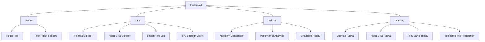

# UI/UX Design

## Navigation Map

## Route Table and Theme Assignment

| Route | Page | Theme |
|---|---|---|
| `/` | Dashboard | Dashboard theme |
| `/games/tic-tac-toe` | Tic-Tac-Toe gameplay | Dashboard theme |
| `/games/rps` | Rock Paper Scissors gameplay | Dashboard theme |
| `/labs/minimax` | Minimax Explorer | Graph theme |
| `/labs/alpha-beta` | Alpha-Beta Explorer | Graph theme |
| `/labs/search-tree` | Search Tree Lab (both games) | Graph theme |
| `/labs/rps-strategy-matrix` | RPS payoff matrix + equilibrium | Dashboard theme (matrix/probability panels) + Graph theme (educational sequential panel) |
| `/insights/comparison` | Algorithm Comparison | Dashboard theme |
| `/insights/performance` | Performance Analytics | Dashboard theme |
| `/insights/history` | Simulation History | Dashboard theme |
| `/learning/minimax` | Minimax Tutorial | Dashboard theme |
| `/learning/alpha-beta` | Alpha-Beta Tutorial | Dashboard theme |
| `/learning/rps-game-theory` | RPS Game Theory | Dashboard theme |
| `/learning/viva-prep` | Interactive Viva Preparation | Dashboard theme |

**Rule:** the graph theme is reserved for pages whose primary content
*is* a search-tree/graph visualization. Every other page — including
gameplay, matrices, charts, and tutorials — uses the dashboard theme.
This keeps the "watching an algorithm think" experience visually
distinct from "reading a result."

## Theme 1 — Graph Theme (Algorithm Visualizations)

Reference: dark graph visualization (Reference 1).

| Token | Value intent |
|---|---|
| Background | Near-black navy (`#05060c`-range) |
| Primary node (MAX) | Glowing cyan |
| Secondary node (MIN) | Glowing purple |
| Pruned node | Desaturated grey, reduced opacity |
| Active edge (search path) | Glowing gradient cyan→purple |
| Panel chrome | Flat dark, minimal borders, monospace accents for board/value readouts |

Interaction: left-side control rail (algorithm/difficulty/replay
controls), canvas supports zoom and pan, click-to-inspect any node.

## Theme 2 — Dashboard Theme (Gameplay, Analytics, Learning)

Reference: premium purple dashboard (Reference 2).

| Token | Value intent |
|---|---|
| Background | Deep violet gradient |
| Card surface | Glassmorphism (translucent, blurred, soft border) |
| Primary accent | Purple / magenta |
| Secondary accent | Cyan / teal (used for positive metrics, chart highlights) |
| Shape language | Rounded panels, soft shadows |
| Typography | Professional sans-serif, clear numeric hierarchy for scores/metrics |
| Charts | Recharts, animated transitions on data change |

## Consistency Rules

- One shared navigation shell (sidebar/topbar) wraps both themes; only
  the content area switches theme.
- Both themes share the same type scale, spacing scale, and icon set —
  only color and surface treatment differ, so the product reads as one
  system, not two unrelated skins.
- No third visual theme is introduced anywhere in the application.

## Responsiveness & Accessibility

- All pages usable down to common tablet widths; graph-theme pages
  degrade gracefully to a simplified pan-only view on small screens.
- Color is never the only signal: pruned nodes also get a visual
  treatment (opacity/pattern) beyond color, and win/loss/tie states in
  RPS use icon + text, not color alone.
